# Emergency terrain repair — rendered evidence

[Engineering report](../../EMERGENCY_REPAIR.md) · [Exact cameras, geometry and slope audit](audit.json)

Seed 42, preview time 70, fixed eye/target/FOV, scenario lighting. Supplemental high-sun views are labeled separately.

| View | Baseline 7b9454dc | Emergency repair |
| --- | --- | --- |
| B: Original detailed outcrop |  | 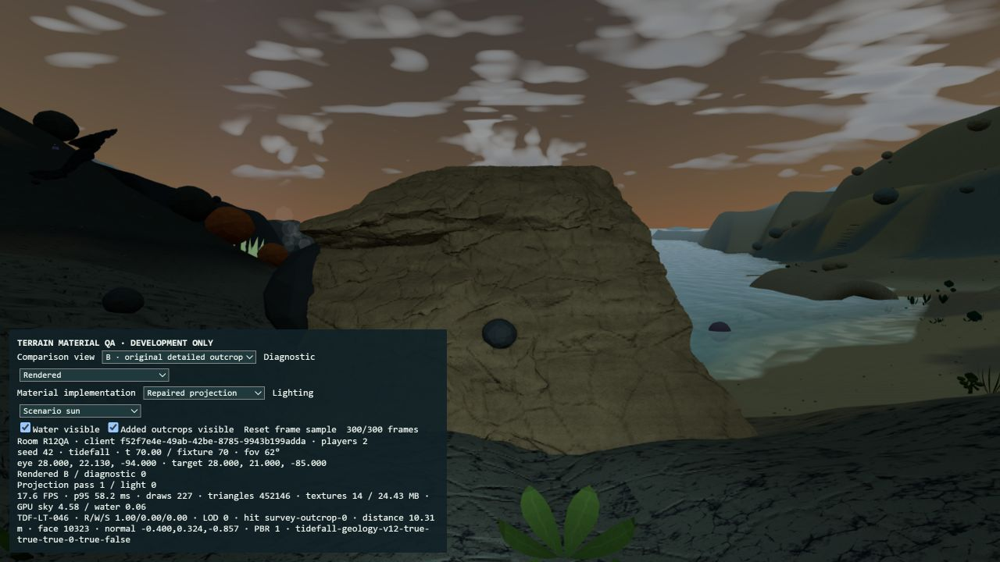 |
| A: New flow exposure | 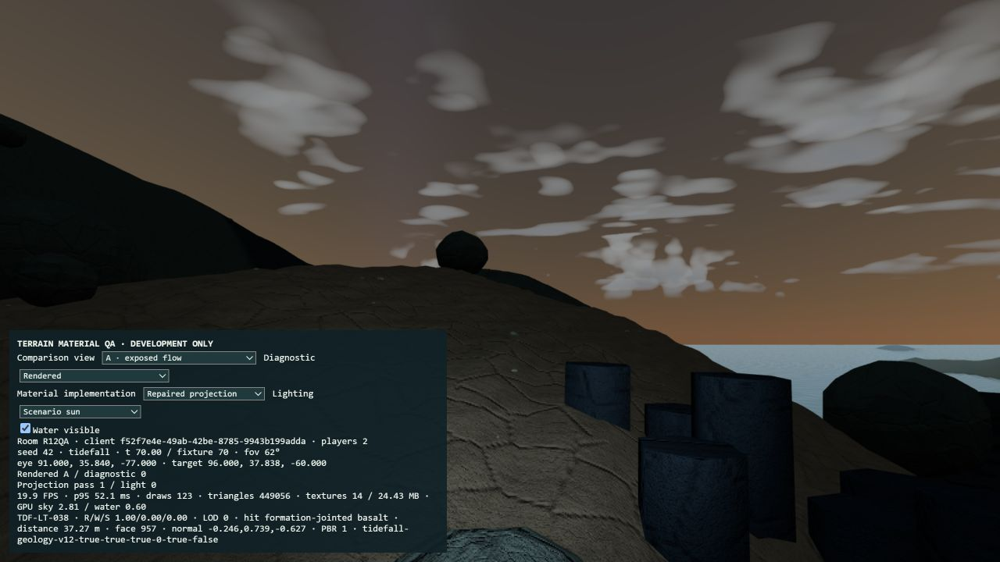 |  |
| C: New carbonate exposure | 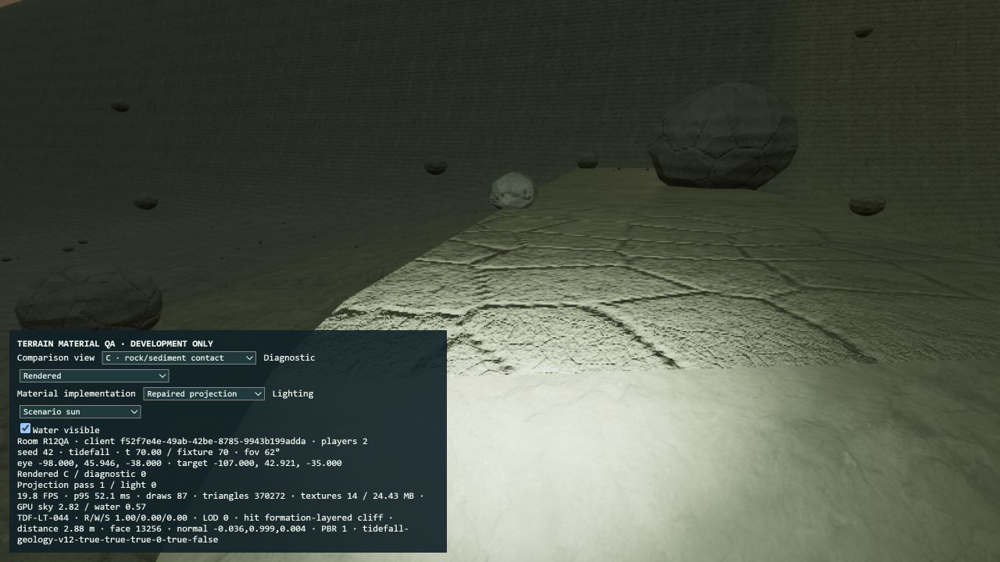 | 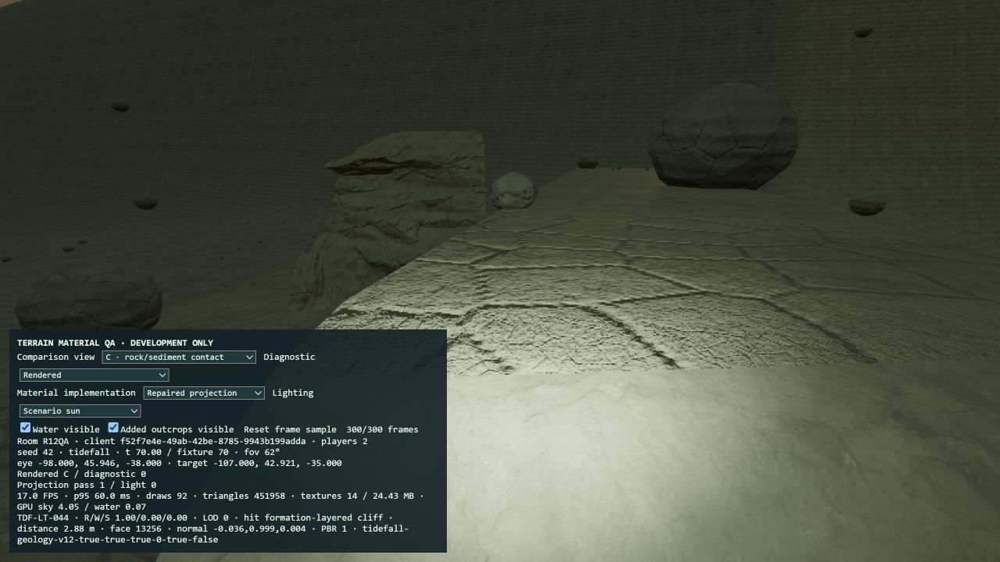 |
| E: Steep face | 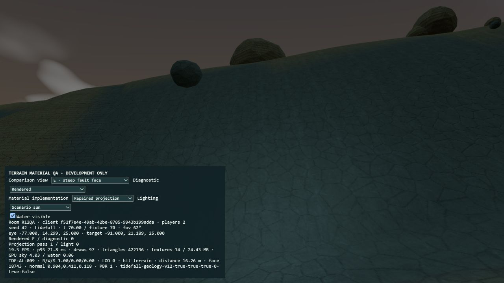 | 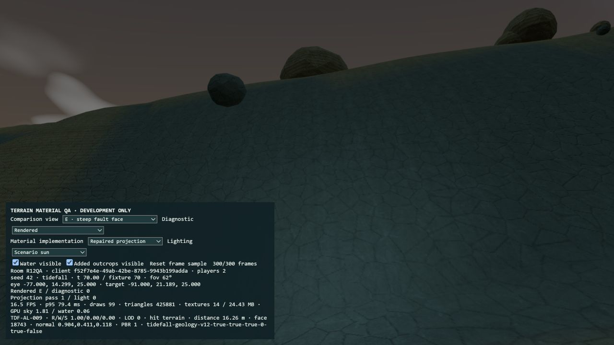 |
| F: Distant mountain | 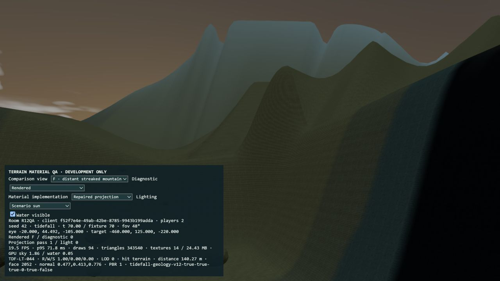 | 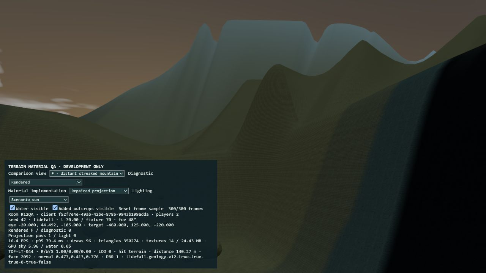 |
| G: Second ridge | 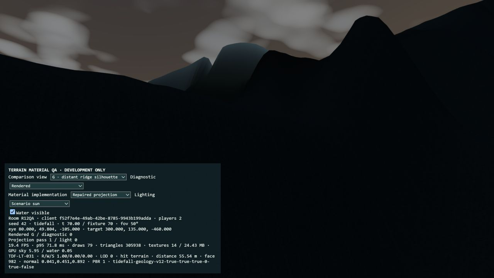 | 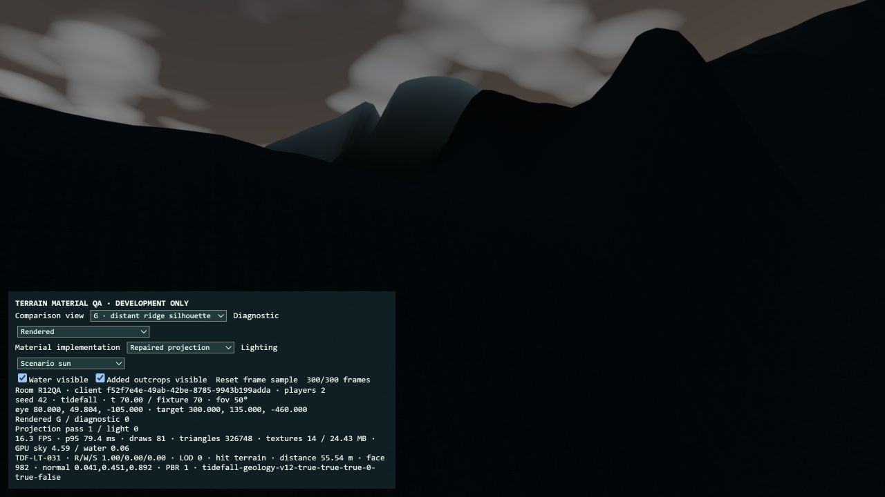 |

## Isolated slope gate

[Stage B / F](stage-b-F.png) · [Stage B / G](stage-b-G.png)

## Supplemental integration views

[Flow exposure from farther away](after-A25.png) · [Carbonate region from farther away](after-C25.png). An existing creature crosses the latter view. These are supplementary after-only views.

## High-sun checks

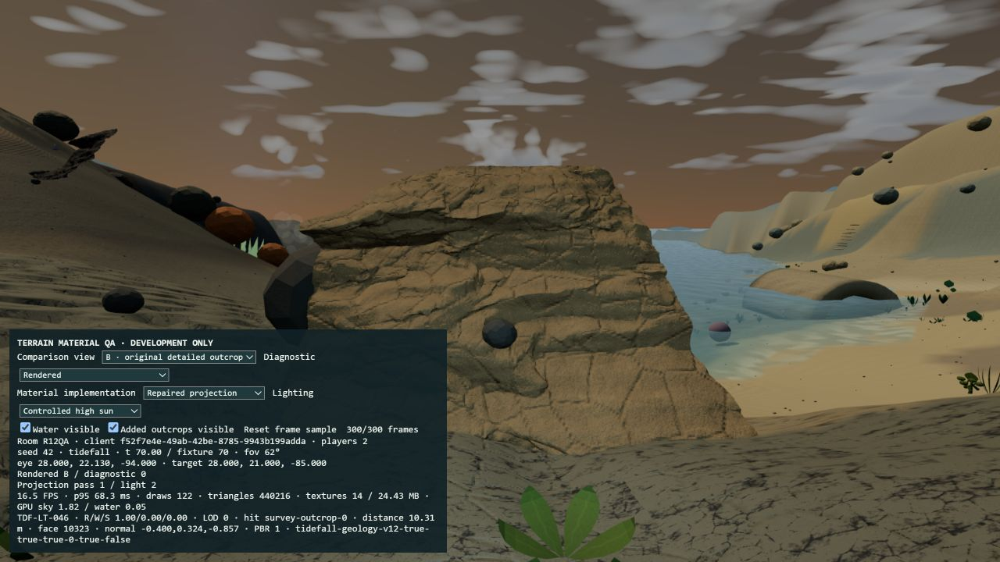

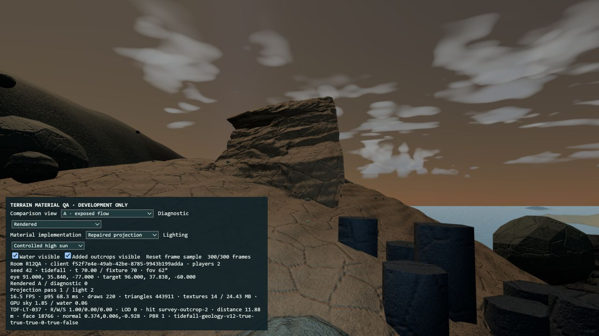

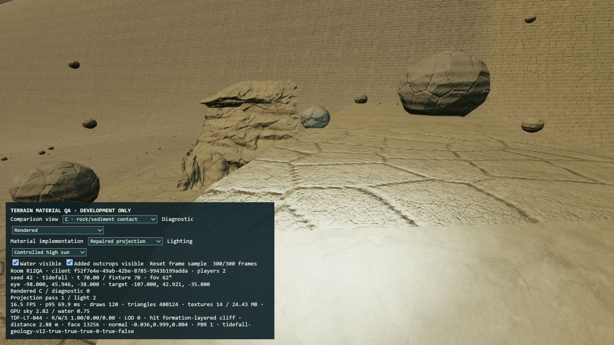

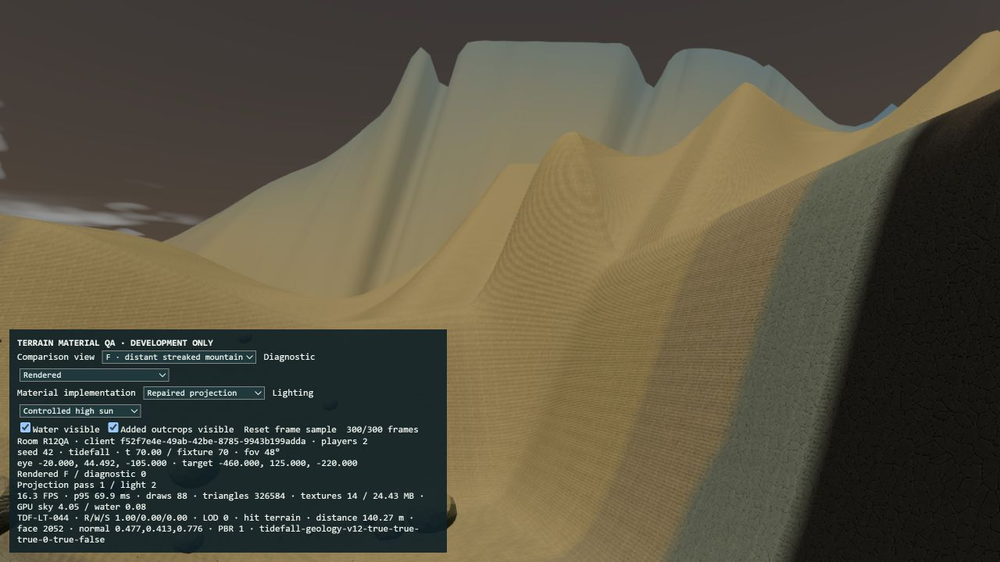

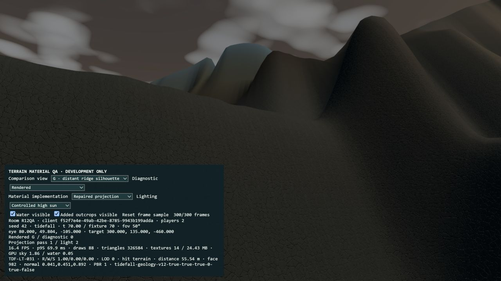

## Rejected orientations

The first two placements presented the thin edges of the source mesh. They were rotated before acceptance; the carbonate sample was subsequently moved and reduced.

[Rejected A](rejected-edge-on-A.png) · [Rejected C](rejected-edge-on-C.png)

## Render-only geometry cost

Same camera and materials, 300-frame samples with the two added render groups hidden/visible.

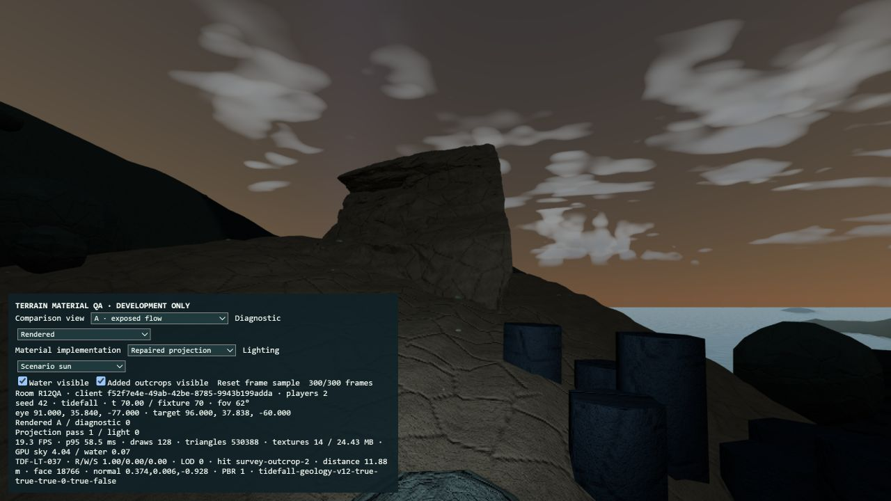

[Hidden sample state](performance-hidden.txt) · [Visible sample state](performance-visible.txt)

[Rejected oversized carbonate placement](rejected-tall-contact-C.png) · [Production handoff](production-title.png)
