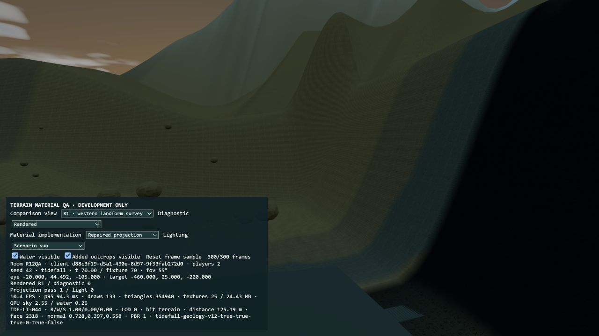
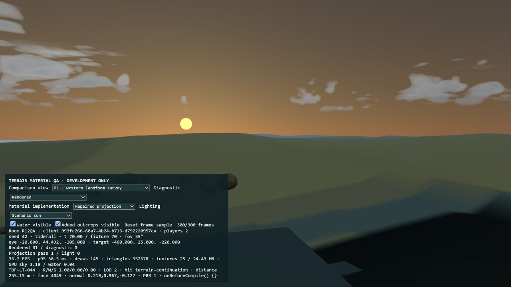
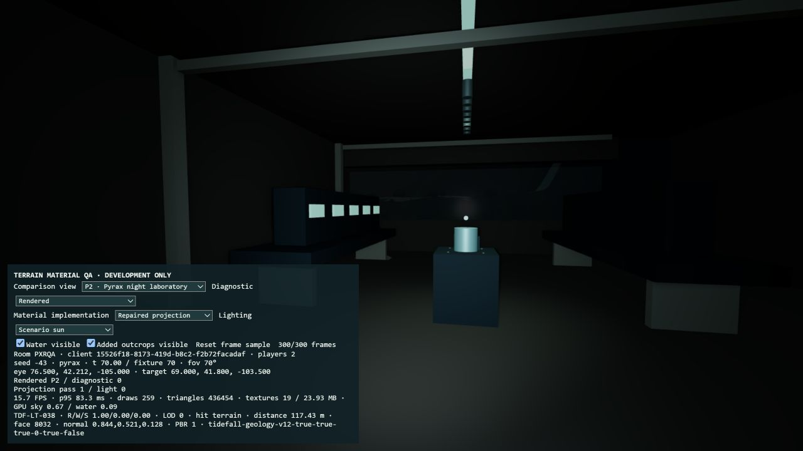
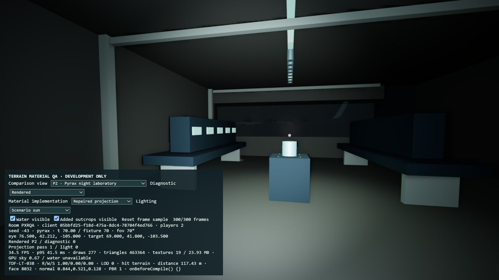
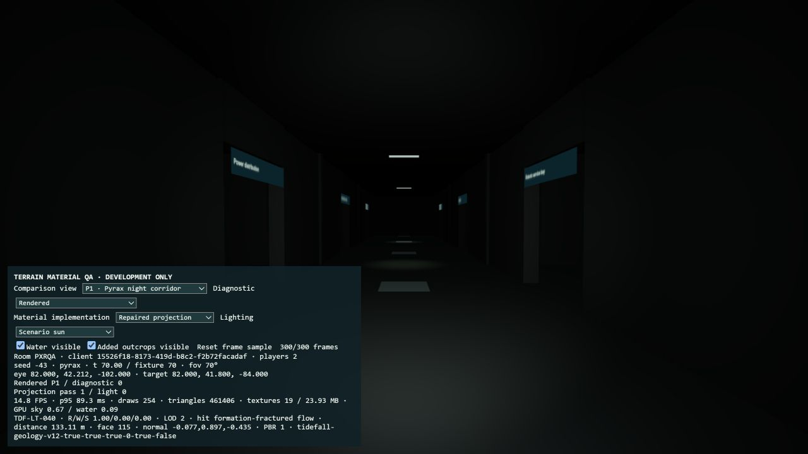
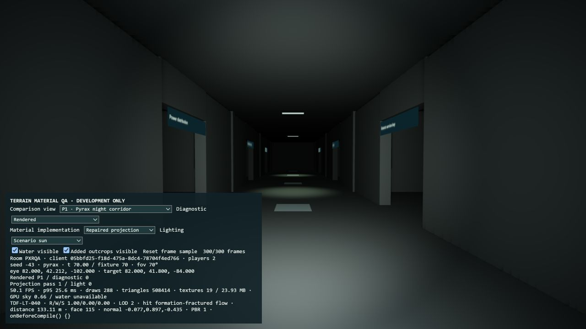
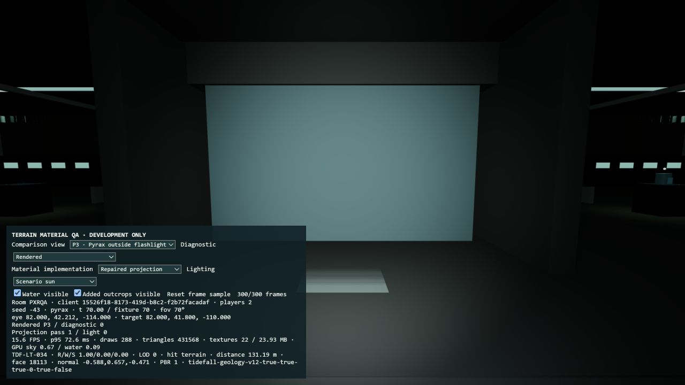
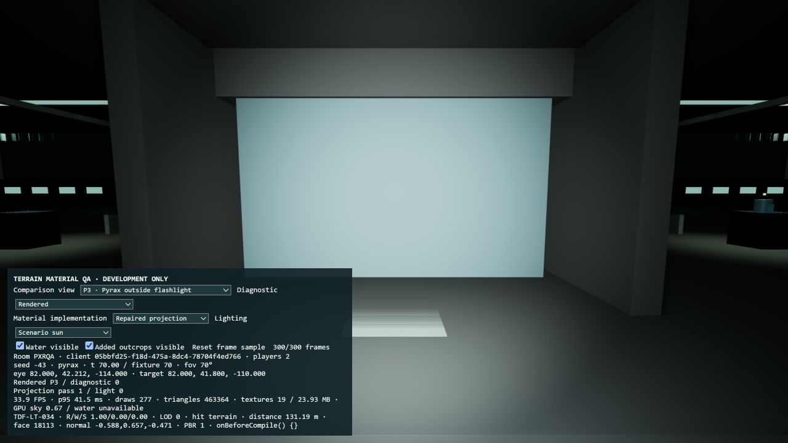
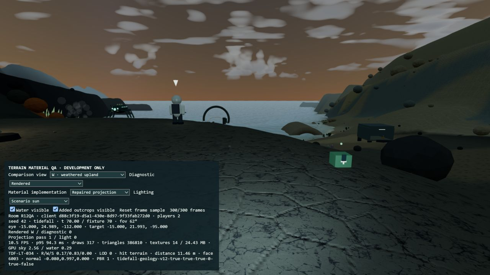
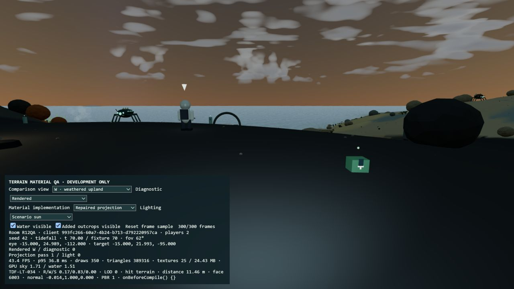

# Geomorphology and lighting comparison

The original source is retained at commit `20e68cbaeee49fb158428235fa7a2b62420ae316` and branch `codex/tidefall-geomorphology-baseline`. Changes are on `codex/tidefall-geomorphology`. The verified production game runs at http://localhost:4174/.

These are original browser screenshots, without colour correction or image enhancement. Coastal comparisons use seed 42, simulation time 70; volcanic comparisons use seed -43, time 70 (solar elevation approximately -12.4°). Position, target and FOV are fixed within each before/after pair. The development panel identifies the rendered camera. Its presence is limited to development QA; the production HUD screenshot has no pointer information overlay.

| Comparison | Before | After |
|---|---|---|
| Western landscape, identical R1 pose |  |  |
| Laboratory at night, identical P2 pose |  |  |
| Night corridor, identical P1 pose |  |  |
| Exterior door flashlight, identical P3 pose |  |  |
| Coastal player view, identical W pose |  |  |

The required D/E/F/G baseline and final images are also included. `surface-only-D/F/W` captures show the simple material before any geometry changes. Removing the artificial elevations changes what those historical cameras see: D is below the reconstructed hillside, while F/G point above the much lower skyline. Their original poses are retained without reframing. Additional D2/E2 ground-level cameras and R1/R2 surveys show the actual reconstructed surfaces; D2/E2 have no claimed historical comparison. All camera definitions are in `cameras.json`.

The new landscape is deliberately lower and rolling. It replaces the previous towering boundary walls rather than retaining their height with different surface detail. Broad vertex colours remain simple; facilities and other assets retain their existing materials. The rendered laboratory now reveals its benches, equipment, frame and floor, with dark areas still present beyond the useful lamp reach. No atmospheric or global exposure change was used to brighten it.

The coastal fault is now 12 m across a 55 m transition; the border uplift is removed. Domain-warped regional, intermediate and local fields replace the periodic apron peaks. Twelve square rings retain the exact shared inner edge and ocean ordering. The original two imported rocks remain, supported on the reconstructed coast; the two recent additional instances were removed.

Measured triangle statistics from the checkpoint and final geometry are in `measurements.json`:

| Coastal geometry | Before | After |
|---|---:|---:|
| Near terrain, median slope | 15.7° | 9.0° |
| Near terrain, 95th-percentile slope | 64.6° | 22.6° |
| Near terrain below 15° | 48.0% | 77.0% |
| Near terrain above 40° | 21.4% | 0% |
| Near terrain triangles | 32,768 | 32,768 |
| Distant terrain triangles | 5,120 | 11,264 |
| Imported rock triangles at full detail | 80,696 | 40,348 |

The combined full-detail terrain/imported-rock budget decreases by 34,204 triangles. This is a geometry budget, not the visible draw count; existing LOD and culling remain active.

Performance observations are recorded in the screenshot panels and adjacent text snapshots. At F, the baseline showed 12.8 FPS / p95 95.6 ms; the surface-only stage showed 15.7 FPS / p95 62.5 ms. The final F sample of 300 frames showed 47.5 FPS / p95 28.1 ms; a separate final R1 sample showed 36.7 FPS / p95 38.5 ms. These are local development observations, not a controlled speedup measurement: baseline captures had additional active WebGL content, background load varied, and the geometry changes affect visibility. Texture storage remains approximately 24.43 MB because other textured assets are retained. No stable 60 FPS claim is made.

Validation completed:

- Tidefall: 163/163 tests; typecheck and production build pass. The final landform adjustment also passes the four focused geomorphology tests.
- Root Resolve: 385 tests pass, one conditional OCR/source fixture test skips because its external fixture/endpoint prerequisites are unavailable; typecheck passes.
- Tests check the exact shared terrain edge, deterministic asymmetric landforms, slope bounds, physical terrain rays, retained imported-rock collision, supported structures, all four offshore water sides, and identical near/far water elevation/depth at the shared boundary.
- Volcanic playable terrain and its original imported-rock geometry retain their checkpoint hashes. Marine lamp settings and attenuation are unchanged. Volcanic lamps use 45/55 power and 9 m reach; the suit lamp retains at least 0.65 relative power indoors and receives the requested 1.5× intensity factor and wider fill/reach.
- Browser checks cover the fixed geometry/lighting views, shoreline appearance, and an ordinary production round without automatic hover information or mouse-capture foreground banners. Discovery collection and the Tab record remain available. No new claim of native pointer-lock testing is made.

The existing coarse rocks, procedural formations and distant radial mesh still have a stylized appearance. This round adds no new high-resolution assets, fine terrain normals, imported rocks, water simulation changes, cloud changes, creature behavior or facility architecture.
