# Round 10 browser evidence

Captured from the running game on 2026-10-30. These are browser screenshots, not concept art. QA used the local-only `tests/preview.ts` server, deterministic seed/time/position fixtures, protected suits and frozen scenario clocks where needed. UI keyboard input exercised movement, doors and seats. Production has no fixture endpoint. The user-supplied reference photographs were unavailable among accessible files, so there is no direct photographic comparison.

## Detailed geology and storms

Final seed 42 cliff, near (28, -90), time 5 s. The separately licensed CC0 mesh provides actual bedding lips, cavities and weathered relief; its exact collider and support query share the mesh. The inspection identifies the exposed modeled bedrock LT-046. A simpler loose rock remains visibly stylized in front of it. Broad terrain beyond the detailed outcrop remains procedural.

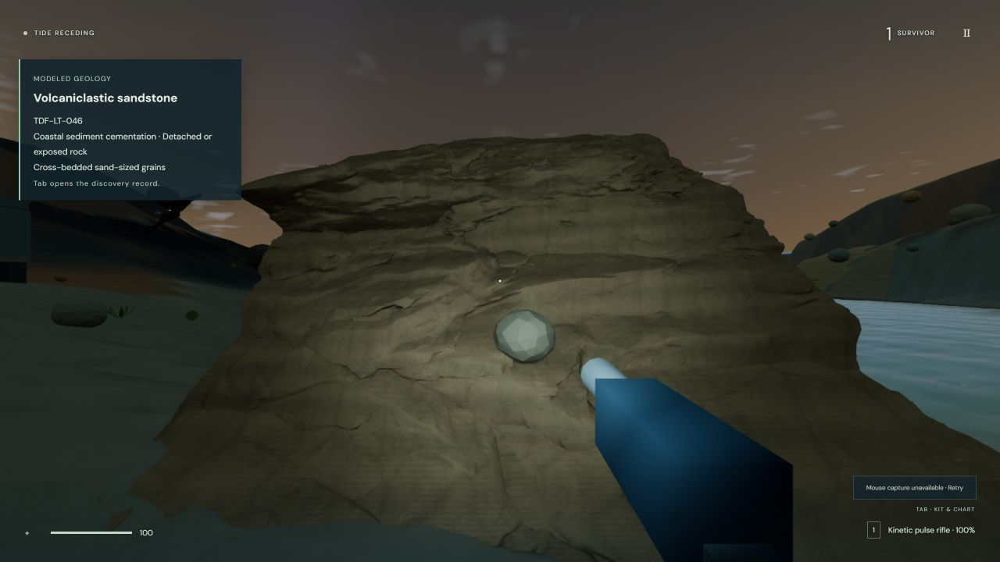

The same region at staged preview time 120 s, with storm clouds and rain. Six-sample cloud volume rendering is an approximation; it is not a physical atmospheric simulation.

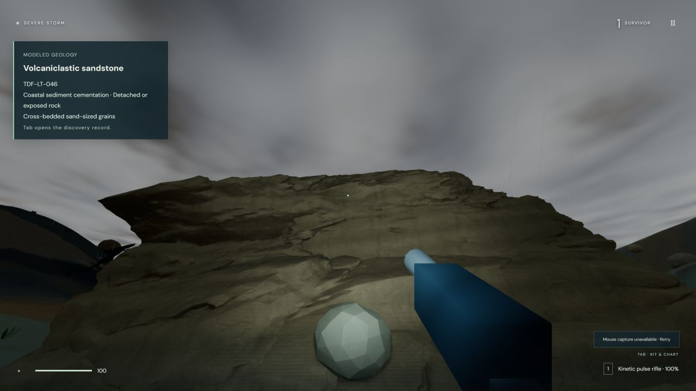

## Facilities

Marine facility: reached through its airlock into the physical corridor. This image predates the later Pyrax site relocation and final material-identity correction; the marine layout shown is retained.

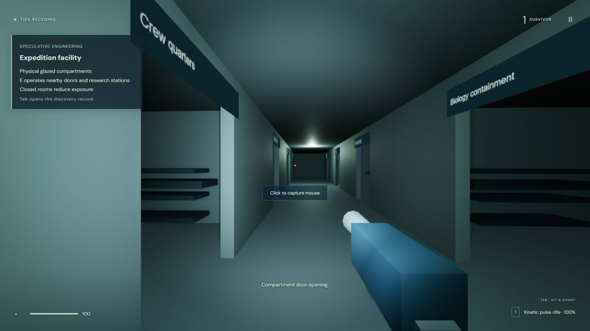

Final Pyrax site at (82, -90), seed -43, frozen time 5 s. The screenshot looks along its supported ramp from z=-139. The browser then walked up from z=-132 without jumping, operated the outer/inner airlock, and entered the service spine. Nightside lighting remains dark and modular geometry is plainly visible.

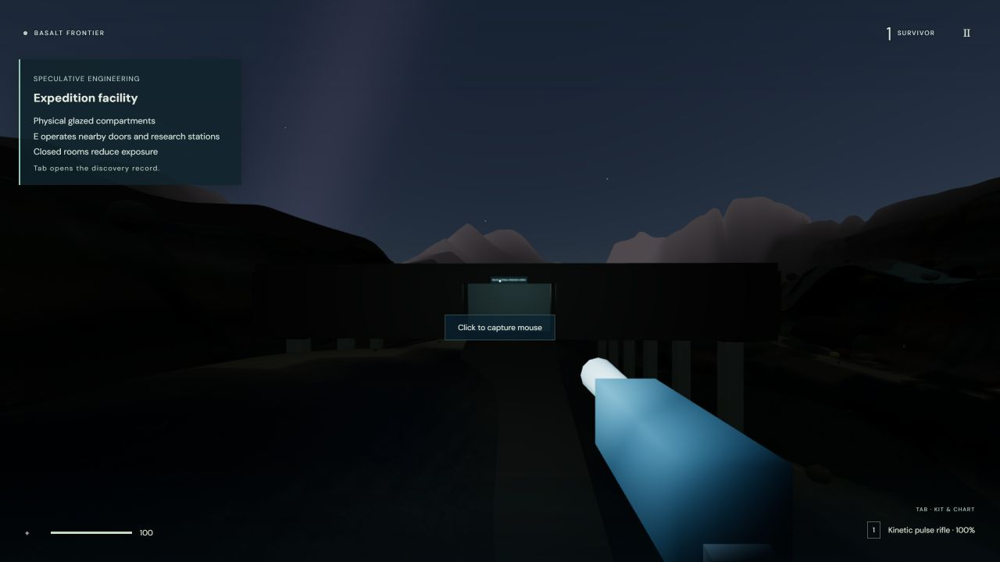

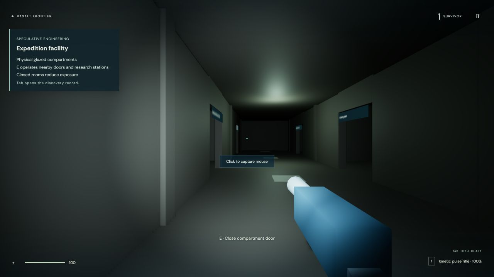

The local vent near (68, 2) has a server-updated thermal lava surface with cooling and flow. Existing emissive fracture stripes, crystal forms and steam retain a stylized appearance. This still image alone cannot prove transport; focused numerical tests verify downhill flux, cooling and conservation.

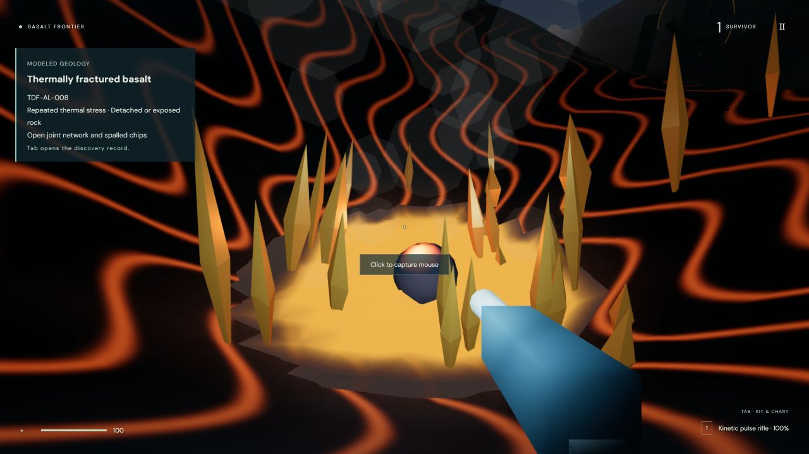

## Cabin and extraction

Actually boarded through the gangway, registered with E, approached a free seat and sat with E. Seat and console collision use the shared local cabin contract.

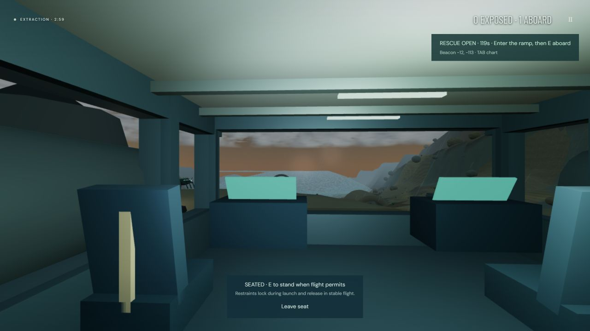

E unseated, then WASD moved along the deck before launch.

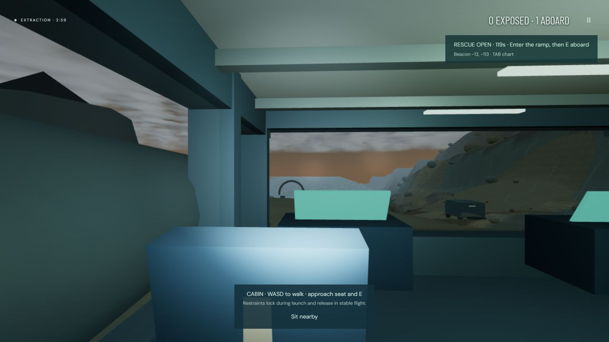

During boarding-close/ascent safety, E could not unseat the restrained passenger.

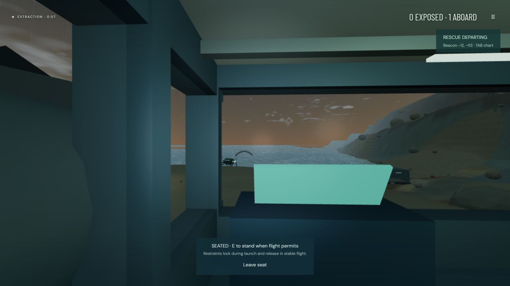

After reaching orbit, E unseated the passenger and keyboard input moved within the cabin. These two images show the later corrected planet-pole orientation, ocean/clouds and transparent window view.

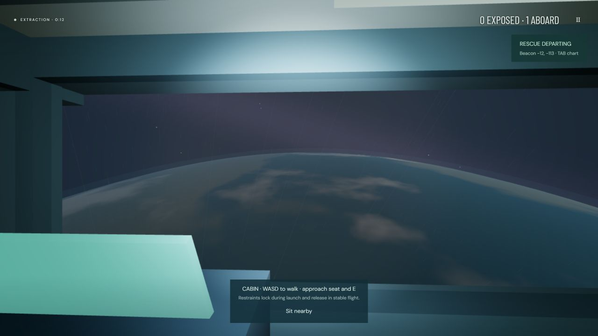

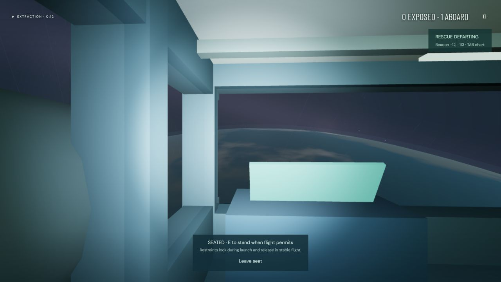

Continuous normal-clock ascent: 42.056 seconds captured, 458 source frames, every fourth frame retained for a 115-frame animated WebP. This recording predates the final polar-axis correction, so its gray polar-cap appearance is superseded by the orbital screenshots above. The seat/reference-frame implementation is the same. It does not establish native Pointer Lock reliability or quantify jitter.

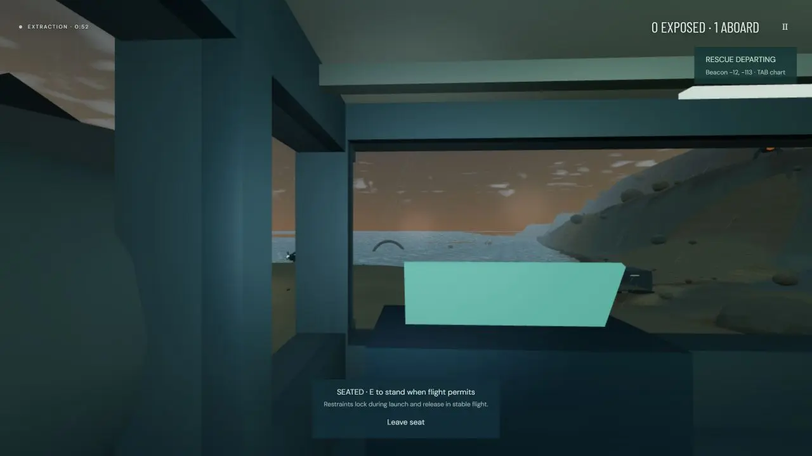

`orbital-walking.png` is also preserved as an earlier pre-axis screenshot, not the final orbital appearance.

## Measured limitations

1280×720 IAB, final scan/PBR geometry, active local QA/server/test processes. These are observed samples, not a controlled GPU benchmark or a before/after Round 9 comparison.

| View | Observed result |
| --- | --- |
| High coastal storm | 18 FPS, frame 56.3 ms, p95 80.1 ms, 249 calls, 515k triangles |
| Low same storm region after warm-up | 31 FPS, frame 32.7 ms, p95 45.7 ms, 122 calls, 247k triangles |
| Low after diagnostic HMR/pitch reset, saved below | 29 FPS, frame 34.4 ms, p95 54.0 ms, 133 calls, 248k triangles |
| Pyrax vent | 32 FPS, frame 31.7 ms, p95 38.0 ms, 127 calls, 365k triangles |

The final Low screenshot reports estimated mapped texture storage 24.42 MiB, sky GPU 4.78 ms, water 0.03 ms, physics 7.51 ms, AI 3.63 ms, snapshot encoding 3.96 ms and zero reset correction/overwrite counters. It follows an HMR reset and is not the exact same camera pitch as the 31 FPS sample. Before that reset, one 4.06 m correction followed intentional fixture teleporting. Earlier weather diagnostics accidentally used the normal timeline in the preview and have since been fixed; the High screenshot's HUD storm is correct while its old debug weather line is not.

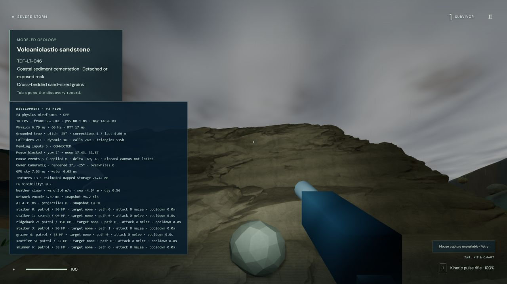

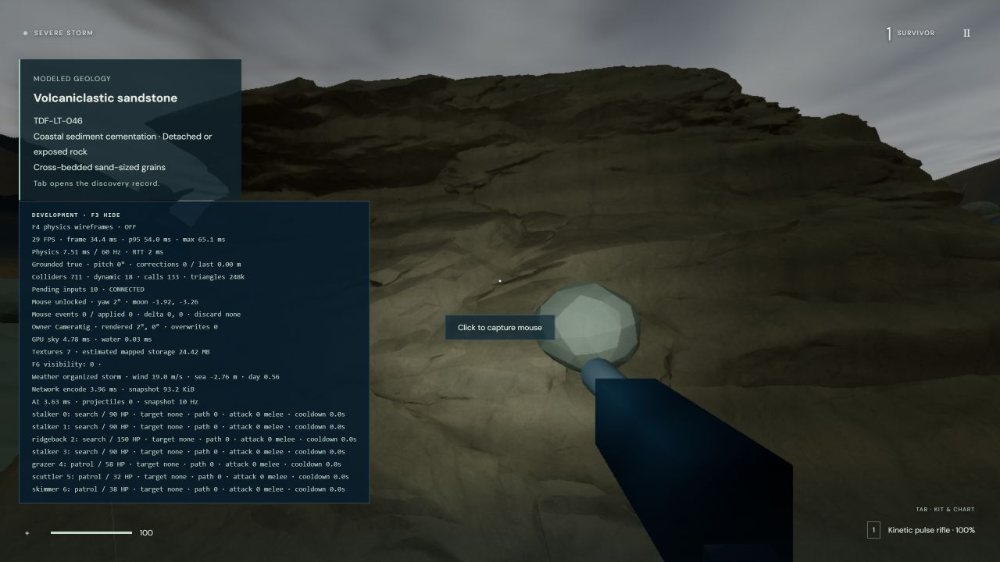

Pyrax's displayed water GPU time is stale from its preceding marine title preview; the dry scenario has no water pass. Treat that field as unavailable for Pyrax.

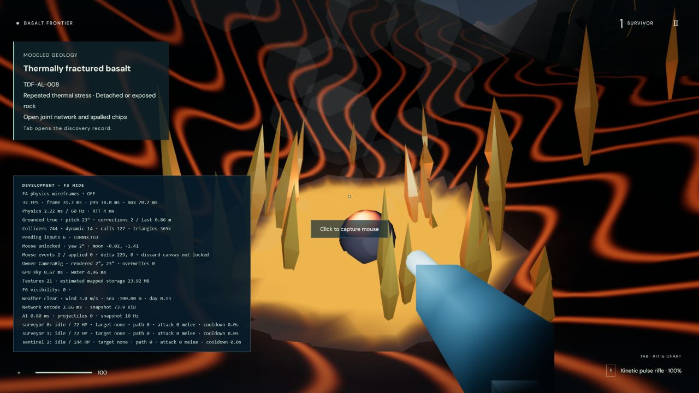

No console errors were captured on the final coastal QA page. Native mouse capture, Escape/Resume and continuous turning were not newly verified; IAB explicitly rejects Pointer Lock. High graphics did not meet a stable desktop frame-rate target on this testing surface.

## Production readiness

Temporary QA tabs and viewport override were removed. The user's existing localhost tab successfully loaded the production title screen at http://localhost:4173. Production health/HTML/assets were checked separately. No public deployment or Docker run was performed.

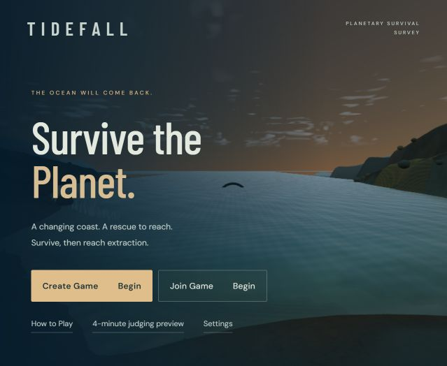
