# Round 11 visual acceptance

Actual browser captures, 2026-10-30, using localhost:4175 and the local-only QA server. Seed/time/position are staged with `scripts/round11-qa.ts`; protected suits and a frozen scenario clock allow inspection. Looking and settings use browser input. All marine cases use seed 42; ordinary terrain comparisons use preview time 70 s, clouds 120 s. The referenced relief example was not available as an image in the accessible attachment.

Baseline images use the Round 10 production client. Updated images document the implementation at the stages stated below. Camera positions and clocks are matched where indicated; live dynamic bodies, animation, look angles and prompts can differ. These are not pixel-identical benchmark frames.

## Terrain propagation and shoreline

Shelf, (0, -65), time 70 s. The high tide has receded enough to reveal the shore and sedimentary ground. The shader now uses continuous exposure/cover weights rather than disabling detail from a categorical regolith ID. The updated image was captured before the final cached cloud-noise optimization; the terrain and water treatment shown is retained.

| Round 10 | Round 11 terrain pass |
| --- | --- |
| 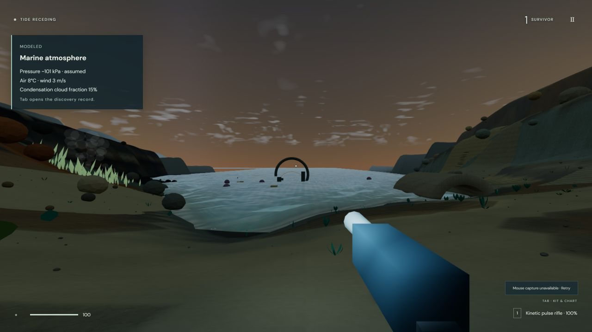 | 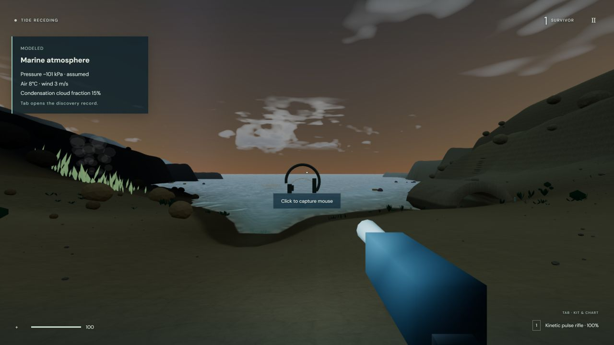 |

Volcanic highland, (104, -81), time 70 s. This preserves the existing rocky relief and photographic materials. The updated image is an intermediate material pass before the later contact fade and cached-cloud optimization; it is not presented as the final cloud appearance.

| Round 10 | Round 11 material pass |
| --- | --- |
| 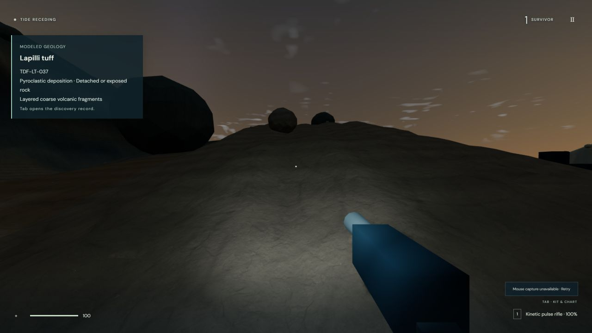 | 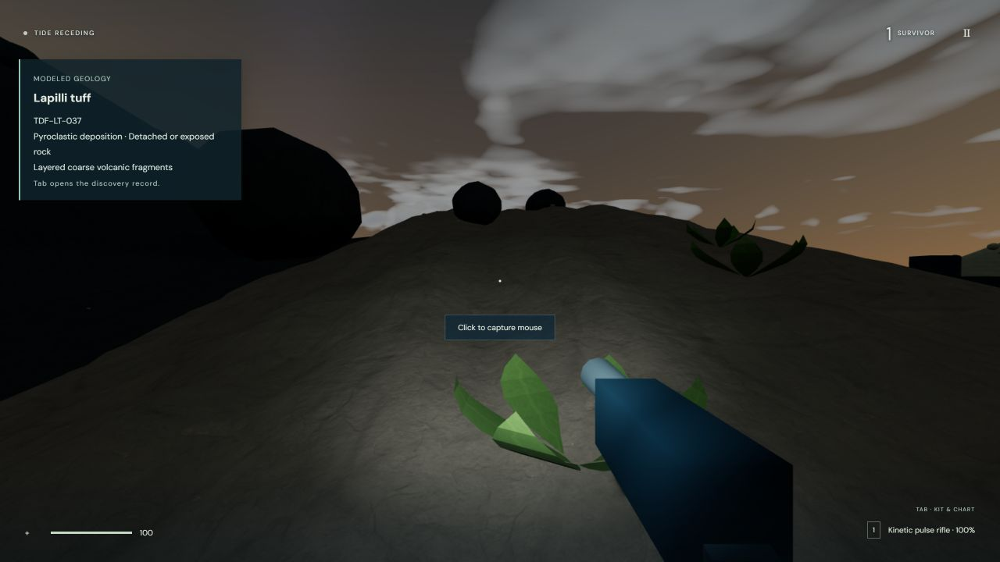 |

Final fault/shoulder material after repairing the polygon-shaped outcrop contact, (-98, -38), time 70 s. Parent ground color and material weights continue into embedded skirts. The underlying relief and background silhouettes retain identical geometry. This image predates only the cached-noise cloud implementation; the final material implementation is shown.

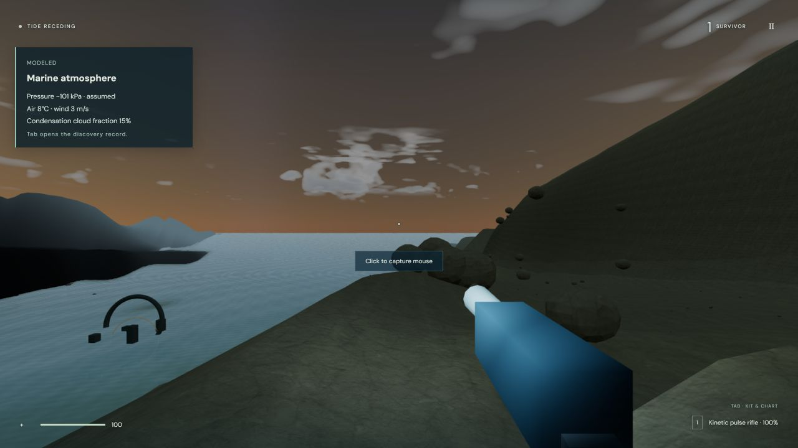

## Plants

Near (61.66, -88.07), time 70 s. Favorable habitats contain clumps with height and density variation. Leaf-relative tissue/vein shading and root-anchored wind apply to all existing growth templates. The world budget remains 260 organisms; these are stylized procedural plants and open ground remains between clusters. Cloud noise was optimized after this capture.

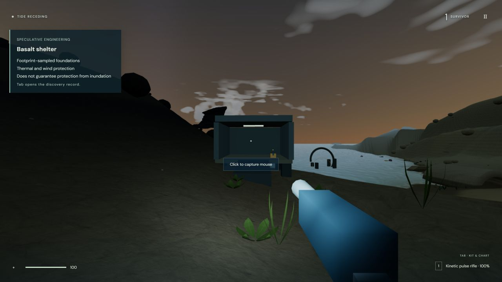

## Water continuity

Near the east boundary, staged (148, 60), time 70 s, looking across the coast. The keyboard look angles differ slightly. The baseline is High; the final after image is Low following the performance check. Compare coverage, contact and wave/foam appearance rather than shadow fidelity. No rectangular gap was observed in this final view. Automated flat-bed checks separately cover all four exterior sides and all 512 shared boundary vertices; one screenshot cannot prove every tide/camera combination.

| Round 10 | Round 11 final water |
| --- | --- |
| 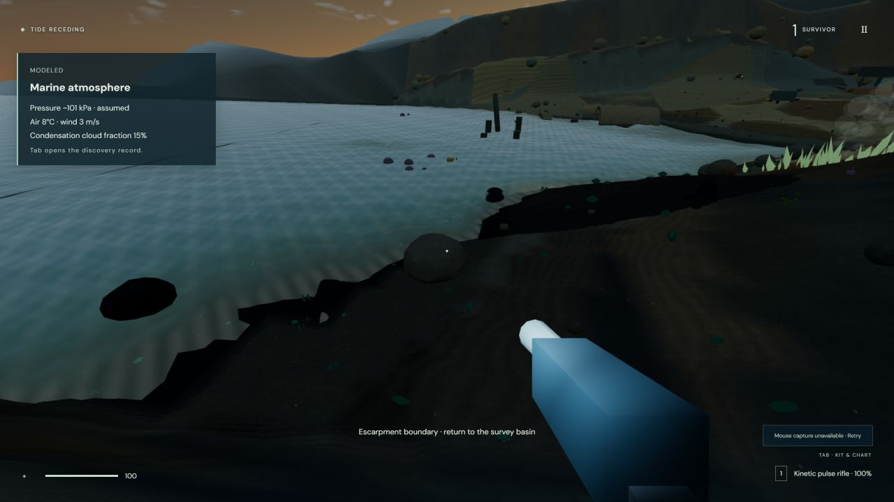 | 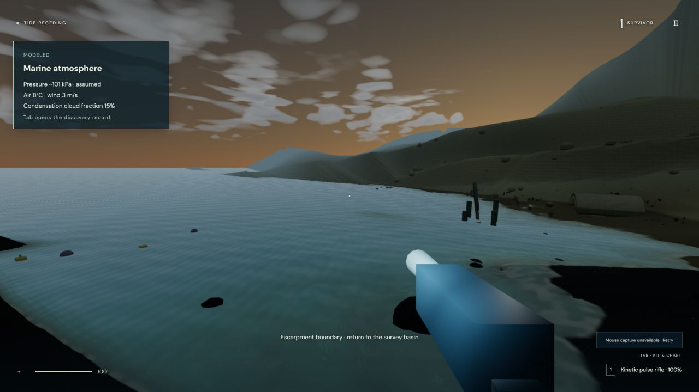 |

The dedicated straight ripple-normal and diagonal foam patterns were removed. Physical directional wave components remain, so the surface is not free of every directional line. Wet ground remains dark at the coast. Exterior water is visual continuation over apron bathymetry, not a larger authoritative fluid grid.

## Facility lighting

Marine corridor, (-56, -112), time 70 s, matching position and forward view. The bright ceiling highlight from unsupported point lighting is replaced by downward illumination under visible fixtures. Room/door geometry is retained. The broad suit lamp is weaker indoors; this is an illumination/material correction, not a global exposure change.

| Round 10 | Round 11 |
| --- | --- |
| 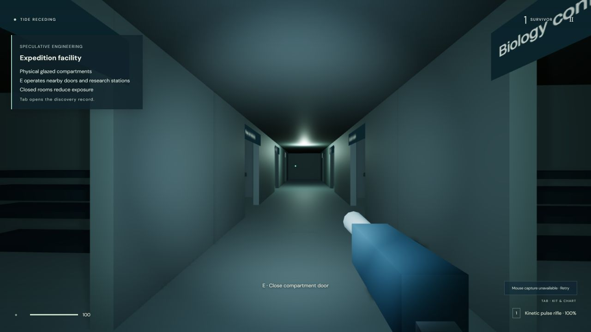 | 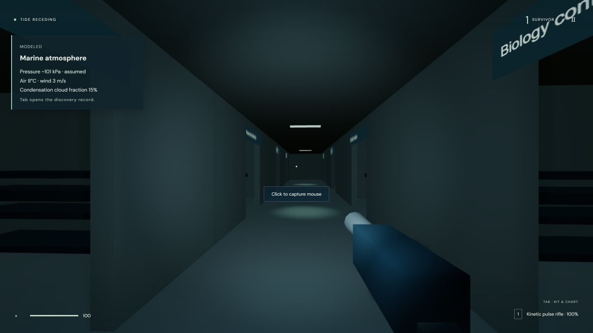 |

## Ocean-world clouds

Staged (0, -65), time 120 s, keyboard look up approximately 45°. The final volume has variable base/top heights, layered density and approximate self-shadowing/light penetration. Cached 3D value noise replaces the expensive arithmetic version. The density realization changes, so cloud outlines do not correspond one for one. Some undersides remain soft or sheet-like; no photographic-equivalence claim is made.

| Round 10 | Round 11 final cached noise |
| --- | --- |
| 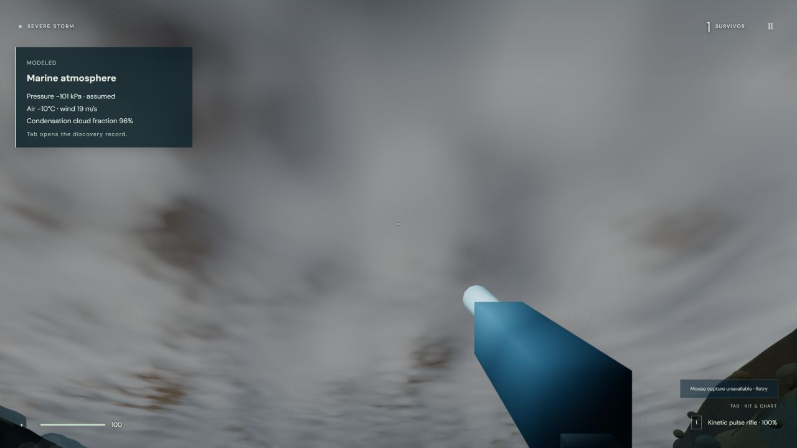 | 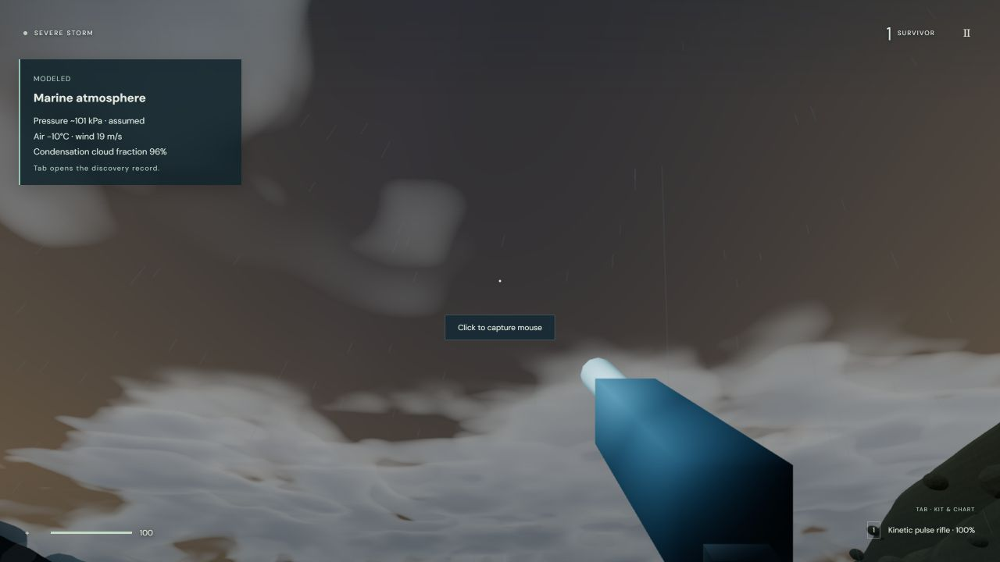 |

## Performance observations

1280×720 IAB with other local processes active. High storm screenshot: 26 FPS, 37.8 ms frame, p95 45.3 ms, about 410k triangles, sky GPU 6.93 ms, estimated mapped texture storage 24.43 MiB. The pre-cache arithmetic revision had a 17.18 ms sky query; a later cached sample showed 5.33 ms. The camera pitch differs by about 1° and the noise realization changed. This is evidence for the optimization, not a controlled hardware speedup percentage.

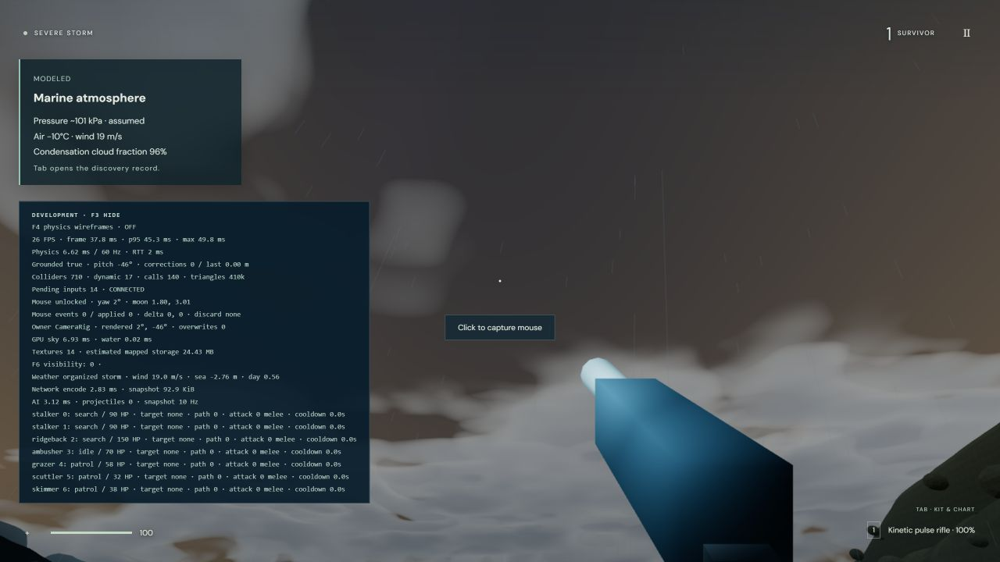

Low after warm-up: 30 FPS, 33.0 ms frame, p95 41.4 ms, 206k triangles, sky GPU 4.54 ms. Native desktop profiling and stable 60 FPS are not established. Mouse capture is explicitly blocked by IAB; it was not bypassed.

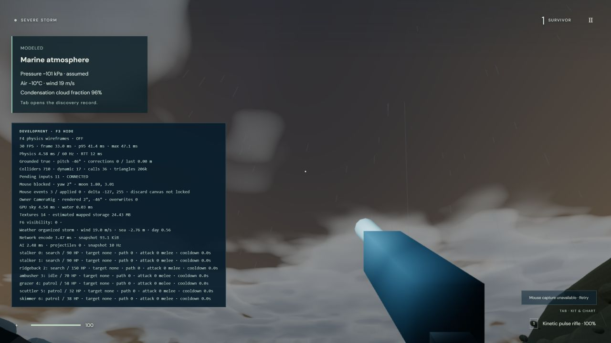

## Pyrax and production

The final Pyrax screenshot checks the existing dark nightside atmospheric mood. Planetary optical/aerosol/tint/fog controls are unchanged, and zero water-cloud coverage bypasses the new cloud code. It is not a direct pixel comparison against a fresh Round 10 Pyrax capture.

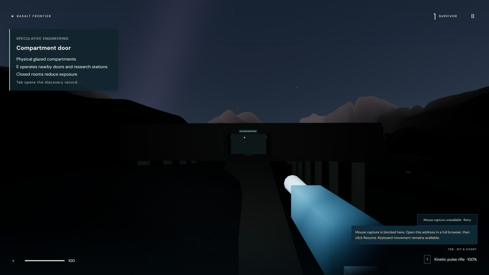

The production title screen at localhost:4173 was opened in a fresh delivery tab after the final build/server restart. The existing user tab was left untouched because its controller was unavailable. This screenshot verifies local readiness, not public deployment.

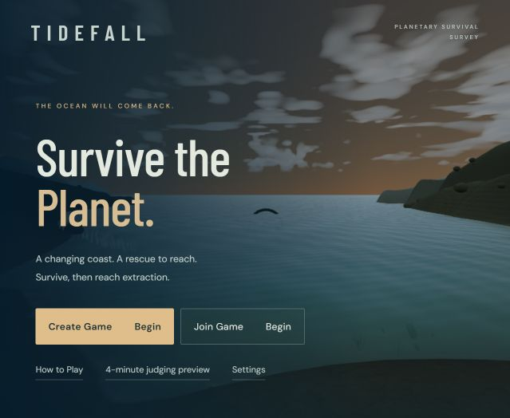
